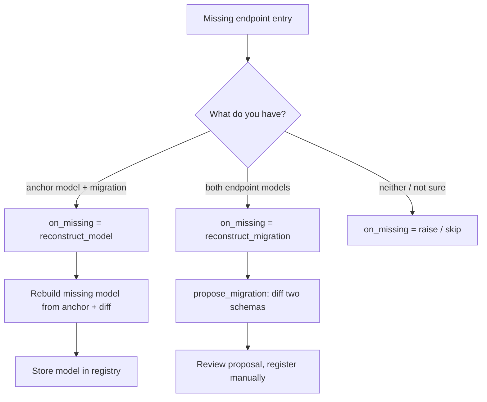

# Migrations

The engine converges every versioned entry in a payload along registered
migration paths. A complete chain needs two kinds of facts:

- a **model** per version (the concrete schema), and
- a **migration** per version edge (how to transform one version into the next).

You normally register both by hand. When one is missing, the engine can
reconstruct it — but only from the other, so the two reconstruction strategies
are **mutually exclusive**. Pick the one that matches *what you are missing*.

## Reconstruction strategies

`on_missing` selects a single, **exclusive** fallback behavior for an edge
endpoint with no concrete entry. The two reconstruction strategies are inverses
and cannot be combined on one engine:

| Value | Axis | You have | Missing | Engine action |
| --- | --- | --- | --- | --- |
| `"reconstruct_model"` | per **migration** (with anchor model) | anchor model + migration | the other endpoint's model | rebuild it from the anchor and the diff, then store it |
| `"reconstruct_migration"` | per **model pair** | both endpoint models | the version-edge migration | diff the two schemas into a proposal |
| `"raise"` (default) | — | — | — | fail with `ModelNotFoundError` |
| `"skip"` | — | — | — | leave the version model-less |

Because the setting is exclusive, enabling one reconstruction path disables the
other. Choose based on which side of the pair your source of truth carries.



### When to choose which

Rule of thumb: **pick the strategy for the half you cannot produce by hand.**

Choose `reconstruct_model` when:

- You version **schemas** and author migrations explicitly — the migration is
  the source of truth and carries business intent.
- You keep one canonical (usually latest) model and treat older versions as
  patch deltas — e.g. git-versioned JSON specs.
- Registering every historical model by hand is the pain point.
- You can accept registry mutation: the engine writes a new model during
  `store_migration`, and it is immediately usable for validation and lookup.

Choose `reconstruct_migration` when:

- You already have every model registered (e.g. generated from schema files or
  ORM classes) but no migration code between versions.
- You want a **starting patch to review**, not an automatically trusted one.
- You want zero side effects: `propose_migration` never registers anything and
  never mutates endpoint models.
- The gap is mechanical (added/removed/retyped fields) rather than semantic.

Avoid or postpone reconstruction when:

- The missing side carries business intent you cannot infer (field renames,
  value remaps, splits/merges) — reconstruct, then **edit** the result.
- The chain has non-adjacent jumps — reconstruction works per edge; register
  the intermediate edges first.
- You want both sides reconstructed at once — they are mutually exclusive by
  design; pick one and register the other by hand.

## Authoring migrations

### Migrations must be total

A migration for an edge **must map every valid source instance to a valid target
instance**. The engine validates the migrated payload against the target model
and raises if it fails, so a bad edge fails loudly — but the engine cannot know
which source instances exist. Totality is the author's responsibility, not
pyverge's.

The classic trap is a **tightened constraint**: the source allows values the
target forbids. The migration must normalize them, or the source must be
constrained so they never occur.

```python
# v2: age: int | None            (any int)
# v3: age: int = Field(ge=0)     (non-negative)
def migrate_v2_to_v3(data: dict, context=None) -> dict:
    age = data.get("age")
    data["age"] = 0 if age is None else max(age, 0)  # normalize, or…
    data["status"] = "active"
    return data

# …constrain the source so negative ages are invalid at v2 in the first place:
# v2: age: int | None = Field(default=None, ge=0)
```

A `ValidationError` from the **target** model during `migrate` is a symptom of a
non-total edge — fix the migration or the source model, don't widen the target.

### Type the payload shapes

Migrations receive and return plain dicts, but each version has a precise shape.
Document it with `TypedDict`: static-only, no runtime cost, and it keeps the
migration body readable (key access, required keys) while the engine's diff
discovery and reconstruction continue to parse the body.

```python
from typing import Literal, TypedDict, cast


class UserData(TypedDict):
    kind: Literal["User"]
    name: str
    email: str


class UserV1Data(UserData):
    version: Literal["1.0.0"]


class UserV2Data(UserData):
    version: Literal["2.0.0"]
    age: int | None


def add_age(data: UserV1Data, context=None) -> UserV2Data:
    return {**data, "age": None}
```

- `TypedDict` is erased at runtime; migrations still receive and return dicts.
- The engine's diff discovery parses the function body: a returned dict literal,
  or subscript assignments/deletes on the parameter named `data`. Keep that name
  (or return a dict literal) so reconstruction still sees the change.
- A type checker may not prove that a dict-building transform returns the target
  `TypedDict` (for example, when the `Literal` version changes); add a narrow
  `cast` or a targeted ignore where the transform is exact.

### Guard totality with a property test

Generate source instances and assert the edge succeeds. This catches tightened
constraints, required fields the migration forgot, and value remaps that miss a
case. See
[Test with property-based payloads → Guard migration totality](../how-to/operations/property-based-tests.md#guard-migration-totality).

## See also

- [Author migrations](../how-to/migrations/author-migrations.md)
- [Reconstruct missing models](../how-to/migrations/reconstruct-missing-models.md)
- [Reconstruct missing migrations](../how-to/migrations/reconstruct-missing-migrations.md)
- [Migration format reference](../reference/migration-formats.md)
- [Test with property-based payloads](../how-to/operations/property-based-tests.md)
