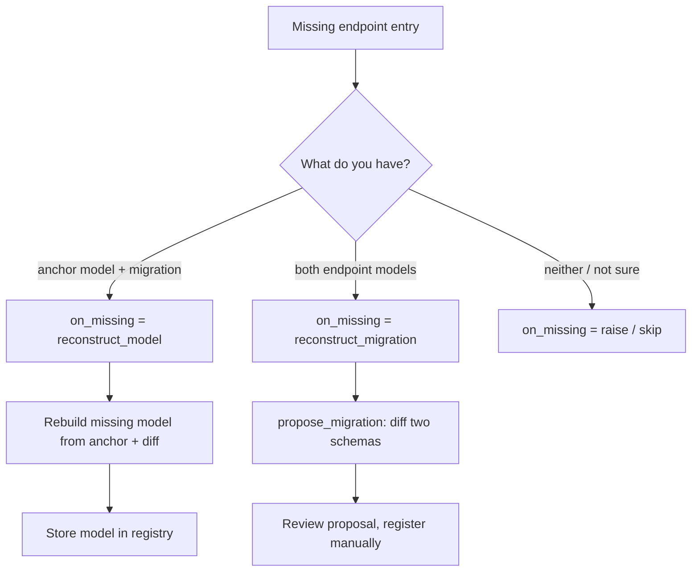

# Migration strategies

The engine converges every versioned entry in a payload along registered
migration paths. A complete chain needs two kinds of facts:

- a **model** per version (the concrete schema), and
- a **migration** per version edge (how to transform one version into the next).

You normally register both by hand. When one is missing, the engine can
reconstruct it — but only from the other, so the two reconstruction strategies
are **mutually exclusive**. Pick the one that matches *what you are missing*.

## Two mutually exclusive strategies

`on_missing` selects a single, **exclusive** fallback behavior for an edge
endpoint with no concrete entry. The two reconstruction strategies are inverses
and cannot be combined on one engine:

| Value | Axis | You have | Missing | Engine action |
| --- | --- | --- | --- | --- |
| `"reconstruct_model"` | per **migration** (with anchor model) | anchor model + migration | the other endpoint's model | rebuild it from the anchor and the diff, then store it |
| `"reconstruct_migration"` | per **model pair** | both endpoint models | the version-edge migration | diff the two schemas into a proposal |
| `"raise"` (default) | — | — | — | fail with `ModelNotFoundError` |
| `"skip"` | — | — | — | leave the version model-less |

Because the setting is exclusive, enabling one reconstruction path disables the
other. Choose based on which side of the pair your source of truth carries.

## When to choose which

Rule of thumb: **pick the strategy for the half you cannot produce by hand.**

Choose `reconstruct_model` when:

- You version **schemas** and author migrations explicitly — the migration is
  the source of truth and carries business intent.
- You keep one canonical (usually latest) model and treat older versions as
  patch deltas — e.g. git-versioned JSON specs.
- Registering every historical model by hand is the pain point.
- You can accept registry mutation: the engine writes a new model during
  `store_migration`, and it is immediately usable for validation and lookup.

Choose `reconstruct_migration` when:

- You already have every model registered (e.g. generated from schema files or
  ORM classes) but no migration code between versions.
- You want a **starting patch to review**, not an automatically trusted one.
- You want zero side effects: `propose_migration` never registers anything and
  never mutates endpoint models.
- The gap is mechanical (added/removed/retyped fields) rather than semantic.

Avoid or postpone reconstruction when:

- The missing side carries business intent you cannot infer (field renames,
  value remaps, splits/merges) — reconstruct, then **edit** the result.
- The chain has non-adjacent jumps — reconstruction works per edge; register
  the intermediate edges first.
- You want both sides reconstructed at once — they are mutually exclusive by
  design; pick one and register the other by hand.

## See also

- [Reconstruct missing models](../how-to/migrations/reconstruct-missing-models.md)
- [Reconstruct missing migrations](../how-to/migrations/reconstruct-missing-migrations.md)
- [Migration format reference](../reference/migration-formats.md)
